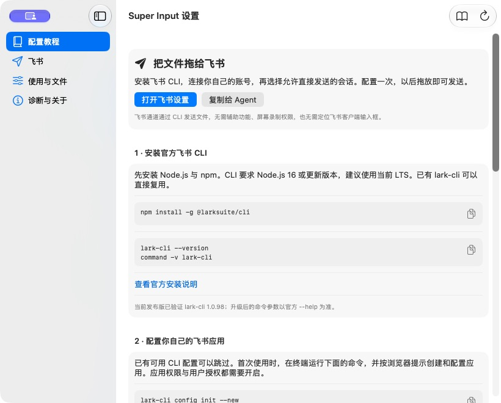

# Super Input

把文件拖给飞书。一个原生 macOS 菜单栏工具，通过官方 [lark-cli](https://github.com/larksuite/cli) 以本人身份向你勾选的会话发送附件。

**当前版本仅支持飞书。** 将文件拖到菜单栏图标下方，移到接收框上半区展开两列授权会话，松手到目标卡片直接发送。保留透明材质、圆形图标、光标点阵和弹簧动效。

Native macOS drag-and-drop file delivery to Feishu using the official Lark CLI and your own user identity. Feishu is the only supported integration in this release.

## 下载与安装

从 [GitHub Releases](https://github.com/HR2AY/super-input/releases) 下载 macOS ZIP，解压后将 `Super Input.app` 放入 Applications 并打开。安装包同时包含 Apple silicon 与 Intel 架构，最低部署目标为 macOS 14；目前实际验证环境为 macOS 27。

这是首次开源预览版。提供的安装包使用临时签名，尚未取得 Apple Developer ID 签名及公证；macOS 可能要求在“系统设置 → 隐私与安全性”中确认打开。也可以在 Xcode 中从源码构建。无需关闭 Gatekeeper 或系统安全机制。

首次启动自动打开“配置教程”。之后可从设置侧栏或菜单栏右键菜单再次打开。



## 快速配置

1. 安装 Node.js 与 npm，再安装官方 CLI（已有安装可复用）：

   ```bash
   npm install -g @larksuite/cli
   lark-cli --version
   command -v lark-cli
   ```

   CLI 的 npm 包要求 Node.js 16 或更新版本，建议使用当前 LTS。本发布版验证过 lark-cli 1.0.98。

2. 尚未配置飞书应用时运行下面的命令，按浏览器提示完成应用配置。已有可用配置可跳过，不要覆盖：

   ```bash
   lark-cli config init --new
   ```

3. 登录本人账号，授权 IM 与通讯录业务权限：

   ```bash
   lark-cli auth login --domain im --domain contact
   lark-cli auth status --json --verify
   ```

   应用在开发者后台的权限与用户授权都需满足。本人发送需要 `im:message.send_as_user`。缺少权限时按 CLI 返回的 `missing_scopes` 和后台链接补齐。

4. 在 **Super Input → 设置 → 飞书** 中填入 `command -v lark-cli` 返回的完整路径，点“保存路径”，再点“读取会话 / 检查连接”。也可使用设置页的“登录 / 补齐飞书权限…”完成用户授权。
5. 亲自勾选允许直接发送的会话，调整顺序。把文件拖到菜单栏图标下方，移到上半区展开会话列表，松手到卡片即发送。

完整配置、故障排查和分步授权见 [飞书 CLI 教程](docs/feishu-cli.md)。设置教程提供“复制给 Agent”，仓库也有 [Agent 配置指南](docs/agent-setup.md)。

## 行为与范围

- 支持普通文件、系统截图和多文件；每个文件最多 **30 MiB**。
- 文件统一作为飞书文件附件发送；文件夹、软件包及符号链接不支持。
- 只发送到用户勾选的会话，使用稳定会话 ID；授权列表绑定当前用户和飞书应用。
- 会话卡片两列排列，五个会话显示为 2／2／1；留白、间隙和未完成展开的区域不触发发送。
- 整批文件先检查再发送，每个文件有独立幂等键。部分成功保留消息凭据；结果不明停止，不自动重试。
- 原文件保留。上传临时副本在结束后清理，暂存区只保存本地副本。
- 飞书通道调用 CLI，**无需操控飞书客户端输入框，也不需要辅助功能或屏幕录制权限**。

## 构建与验证

需要 Xcode（含 macOS SDK）与命令行工具。无第三方 Swift 包依赖。

```bash
bash scripts/check-local.sh
bash scripts/build.sh
```

也可以直接打开 `SuperInput.xcodeproj`，选择 `SuperInput` Scheme 构建。打包脚本生成 `dist/Super-Input-Feishu-v0.2.0-macOS.zip` 与 `SHA256SUMS.txt`，同时支持 arm64 与 x86_64。

测试使用临时目录、模拟账号和模拟投递，覆盖配置保留、授权范围、账号变化、整批文件检查、原文件与临时副本、部分成功、未知结果、CLI 参数及卡片命中。测试不会读取你的 CLI 凭据或发送真实消息。GitHub Actions 运行相同检查并构建通用安装包。

本机配置继续使用 `~/Library/Application Support/SuperInputDemo/`，以保留旧版飞书授权和暂存文件。发布版只读取其中的 `Rules/feishu.json`；其他旧配置不会加载。公开模板的 CLI 路径、账号与会话列表均为空。

## 参与贡献

欢迎修复飞书问题、改进教程、完善文件拖放体验。提交前阅读 [贡献指南](CONTRIBUTING.md)。当前发行范围为飞书；新软件接入应先通过 Issue 讨论接口与维护计划。

请勿上传本机 `feishu.json`、账号和联系人标识、CLI 凭据、配对令牌或真实聊天截图。报告问题请填写 App、macOS 与 CLI 版本以及复现步骤，并隐藏个人信息。

## License

[MIT](LICENSE)。lark-cli 是独立安装的官方依赖，不包含在本安装包中。本项目是独立开源工具。
